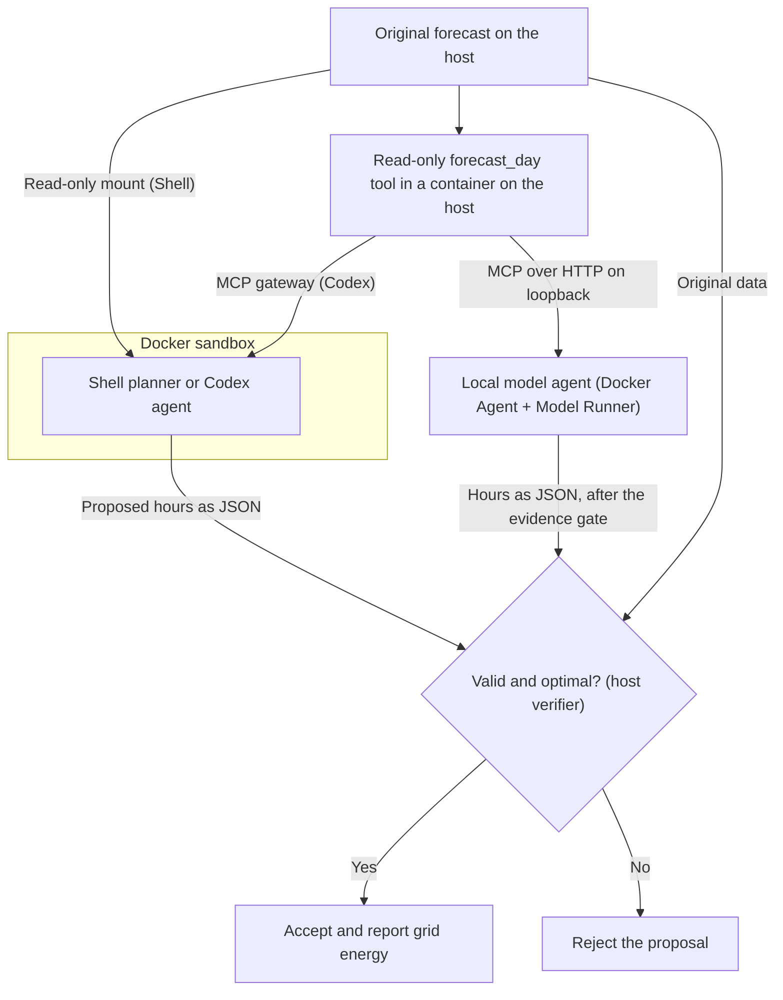

# Solar Dispatch Lab

**English** · [Português do Brasil](README.pt-BR.md)

[](https://github.com/brunovicco/solar-dispatch-lab/actions/workflows/quality.yml)

A hands-on lab of Docker's tooling for AI agents: **Docker Sandboxes, sandbox kits, the MCP gateway, Docker Model Runner, Docker Agent, Docker Hardened Images, and Buildx attestations**. Each finding below was measured with the versions listed and links to its walkthrough section or recorded transcript.

> **Trust the verifier, not the agent.** A planner can only propose. The host decides, using data the planner cannot change and evidence of how the answer was produced.

The task is small on purpose. A synthetic solar forecast lists four hours, and an electric vehicle needs two one-hour charging blocks. Three planners propose the hours that draw the least energy from the grid: a deterministic script and Codex inside Docker sandboxes, and a local model through Docker Agent. One verifier on the host accepts or rejects every proposal.

## Docker features in the lab

| Feature | What the lab does with it | Walkthrough |
| --- | --- | --- |
| Docker Sandboxes (`sbx`) | Runs the planner in a microVM with a writable workspace and a read-only forecast | [1](docs/SANDBOX-LAB.md#1-local-isolation-and-network-policy) |
| Sandbox kits (v3) | Ships the planner tool and a deny-all egress policy in one kit, validated against the official schema | [1](docs/SANDBOX-LAB.md#1-local-isolation-and-network-policy), [3](docs/SANDBOX-LAB.md#3-kit-local-preview-and-supply-chain) |
| Environment files | Declare mounts, pin agent kits by digest, and declare MCP servers | [1](docs/SANDBOX-LAB.md#1-local-isolation-and-network-policy), [2](docs/SANDBOX-LAB.md#2-codex-credentials-and-mcp) |
| MCP gateway | Compares static and dynamic tool catalogs for Codex, with a decoy server | [2](docs/SANDBOX-LAB.md#2-codex-credentials-and-mcp) |
| Docker Model Runner | Serves `ai/qwen3:4b` on the host, with no API key | [5](docs/SANDBOX-LAB.md#5-local-model-through-docker-agent) |
| Docker Agent | Defines the local planner in YAML and runs it headless with a transcript | [5](docs/SANDBOX-LAB.md#5-local-model-through-docker-agent) |
| Docker Hardened Images | Runtime of the application and MCP server images | [3](docs/SANDBOX-LAB.md#3-kit-local-preview-and-supply-chain) |
| Buildx and GHCR | Publishes multi-arch images with SBOM and provenance, and the kit as an OCI artifact | [3](docs/SANDBOX-LAB.md#published-images-and-attestations) |
| Docker Scout | Compares the hardened runtime with the official image | [Supply chain](#supply-chain) |
| Docker Cloud sandboxes | Runs the planner in a short-lived cloud sandbox | [4](docs/SANDBOX-LAB.md#4-cloud-execution-and-transfer) |

## What the experiments showed

1. **A deny in a kit beats any allow.** The kit denies all runtime egress. `github.com`, which the global `balanced` policy allows, was refused with `kit:solar-dispatch:deny`, also after a sandbox-scoped allow. `sbx inspect` does not show kit rules; `sbx policy check` and the log do. [Evidence](docs/evidence/2026-11-20-p1a-static.md)
2. **Static MCP isolates servers the sandbox was not given.** The gateway still offers `mcp_exec` and `code_mode`, but neither reached a decoy server registered on the host. In a dynamic sandbox, the positive control, Codex added the decoy and received its canary. [Walkthrough](docs/SANDBOX-LAB.md#can-a-static-sandbox-reach-servers-it-was-not-given) · [Evidence](docs/evidence/2026-11-20-p1a-dynamic.md)
3. **`mcp.servers` in an environment file selects static mode,** and those servers stay with the environment: loading one into another sandbox returned `403 Forbidden`. [Walkthrough](docs/SANDBOX-LAB.md#contrast-dynamic-mcp-and-the-positive-control)
4. **A malicious answer written inside the sandbox is rejected on the host.** A proposal with a duplicated `hours` key fails with `Duplicate JSON key`, because parsers disagree about which value wins. [Walkthrough](docs/SANDBOX-LAB.md#static-mcp-declared-in-the-environment-file)
5. **A correct answer can be a guess.** The first accepted answer from the local model came without a single call to the forecast tool. The verifier checks results, so the host now also gates on transcript evidence that the agent read the forecast. [Evidence](docs/evidence/2026-11-20-p2-local-model.md)
6. **Docker Agent waits 30 seconds per turn for its tools.** A stdio MCP server started per session with `docker run` took about 44 seconds under Docker Agent, so the model ran without the tool. The same handshake took under 2 seconds from the Python MCP client. A running container that serves HTTP on loopback fixed it. [Walkthrough](docs/SANDBOX-LAB.md#check-the-process-not-only-the-result)
7. **Local models have practical limits.** Tool-mode structured output hit `HTTP 400` from Model Runner's llama.cpp, and reasoning could not be turned off. On a fanless MacBook Air a run took 4.5 to 6 minutes while macOS throttled the chip. [Walkthrough](docs/SANDBOX-LAB.md#structured-output-and-reasoning-with-a-local-model)
8. **The hardened runtime removed every fixable critical or high vulnerability** and shrank the application image from 218 MB to 133 MB. See [Supply chain](#supply-chain).

## Quick start

The verifier runs anywhere with Python 3.13:

```bash
bash lab/demo.sh local
```

The published image needs only Docker, on amd64 or arm64:

```bash
docker run --rm --read-only --network none ghcr.io/brunovicco/solar-dispatch:main
```

The sandbox experiment needs the `sbx` CLI, signed in, on a host that supports local virtualization:

```bash
bash lab/demo.sh sandbox
```

It plans the sandbox environment, creates a Shell microVM, runs the kit's `solar-plan`, and verifies the proposal on the host:

```json
{"decision": "accepted", "hours": [10, 11], "grid_wh": 600}
```

The local model experiment needs Docker Model Runner and Docker Agent v1.147.0 or later. Run `bash lab/agent.sh` after the setup in [section 5](docs/SANDBOX-LAB.md#5-local-model-through-docker-agent). Record your own transcripts with `bash lab/record.sh`, described in [Record evidence](docs/SANDBOX-LAB.md#record-evidence).

## How it works



The verifier reads at most 4 KiB of strict JSON, rejects duplicate keys, and accepts a schedule only if no unused hour would draw less grid energy. The [dispatch model](docs/DISPATCH.md) describes the calculation.

## Supply chain

Both images run on a Docker Hardened Image without a shell or package manager, as an unprivileged user. Docker Scout compared the base images on 2026-11-20 for linux/arm64. It evaluated the published tags, not the pinned digests. See the [evidence](docs/evidence/2026-11-20-p1b-supply-chain.md).

| Runtime base | Vulnerabilities (C/H/M/L) | Fixable critical or high | Root user | Scout health |
| --- | --- | --- | --- | --- |
| `python:3.13-slim` | 0 / 11 / 8 / 34 | 8 | Yes | D (39%) |
| `dhi.io/python:3.13` | 0 / 2 / 11 / 4 | 0 | No | A (94%) |

On every push to `main`, CI publishes to GitHub Container Registry, for amd64 and arm64:

| Package | Contents |
| --- | --- |
| `ghcr.io/brunovicco/solar-dispatch` | Planner and verifier CLI, with SBOM and provenance |
| `ghcr.io/brunovicco/solar-forecast-mcp` | Read-only forecast and decoy MCP servers, with SBOM and provenance |
| `ghcr.io/brunovicco/solar-kit` | Sandbox kit, with its deny-all egress policy in the manifest annotations |

Dependabot keeps base image digests, actions, and Python dependencies current.

## Tested with

| Component | Version |
| --- | --- |
| Docker Sandboxes CLI (`sbx`) | v0.54.0 |
| Docker Agent | v1.163.0 |
| Docker Model Runner | llama.cpp b9879, Metal |
| Local model | `ai/qwen3:4b` |
| Hosts | macOS on Apple silicon; Ubuntu in GitHub Actions |

`sbx env` and parts of Docker Agent are experimental, so commands and file formats may change.

## Repository map

| Path | Contents |
| --- | --- |
| `lab/` | Sandbox environment files, the kit, the Docker Agent planner, and the demo, probe, record, and agent scripts |
| `integrations/` | Forecast and decoy MCP servers, their image, and the MCP checks |
| `src/solar_dispatch/` | Planner, verifier, and the transcript evidence gate |
| `docs/` | [Walkthrough](docs/SANDBOX-LAB.md), [architecture](docs/ARCHITECTURE.md), [dispatch model](docs/DISPATCH.md), and [evidence](docs/evidence/) |
| `governance/` | Inventories of agents, tools, MCP servers, and third parties |

[Development and local checks](docs/DEVELOPMENT.md) · [Governance](governance/README.md) · [License](LICENSE)
