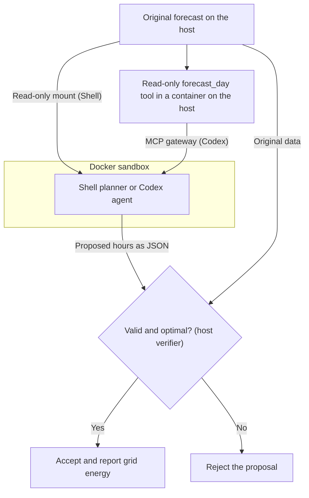

# Solar Dispatch Lab

**English** · [Português do Brasil](README.pt-BR.md)

> **Trust the verifier, not the agent.** A planner inside a Docker sandbox can only propose. The host decides, using a forecast the sandbox cannot change.

Run a charging planner inside **Docker Sandboxes** and verify its proposal on the host. The sandbox gets a writable workspace and a read-only solar forecast. The host keeps the original forecast and makes the final decision.

The exercise uses synthetic data. An electric vehicle needs **6 kWh**, and the planner must pick the two hours that draw the least energy from the grid.

## Run the Docker experiment

From the repository root, with Bash, Python 3.13, and `sbx` signed in on a host that supports local virtualization:

```bash
bash lab/demo.sh sandbox
```

The script shows the environment plan, creates a Shell microVM, and runs the kit's `solar-plan` command. The host verifier prints:

```json
{"decision": "accepted", "hours": [10, 11], "grid_wh": 600}
```

To keep a reviewable transcript of the run, use `bash lab/record.sh` afterwards. See [Record evidence](docs/SANDBOX-LAB.md#record-evidence).

For first-time setup, including local network policy initialization, see the [Docker Sandboxes walkthrough](docs/SANDBOX-LAB.md#1-local-isolation-and-network-policy).

## How the experiment works



## Extend the experiment

| Experiment | What to look for |
| --- | --- |
| [Filesystem and network policy](docs/SANDBOX-LAB.md#1-local-isolation-and-network-policy) | Confirm the workspace is writable and the forecast is read-only. Show that the kit's deny-all egress policy blocks a host the global policy allows, and match the block to its log entry. |
| [Codex through MCP](docs/SANDBOX-LAB.md#2-codex-credentials-and-mcp) | Give Codex a fixed MCP tool catalog, verify its proposal on the host, test whether it can reach a server it was not given, and contrast it with a dynamic gateway. |
| [Buildx and supply chain](docs/SANDBOX-LAB.md#3-kit-local-preview-and-supply-chain) | Build the sandbox kit and application image, serve the forecast on loopback, and export an OCI archive with SBOM and provenance. |
| [Docker Cloud](docs/SANDBOX-LAB.md#4-cloud-execution-and-transfer) | Run the planner in a short-lived cloud sandbox and verify the result on the host. |

[Dispatch model](docs/DISPATCH.md) · [Architecture](docs/ARCHITECTURE.md) · [Governance](governance/README.md) · [Development and local smoke tests](docs/DEVELOPMENT.md)
