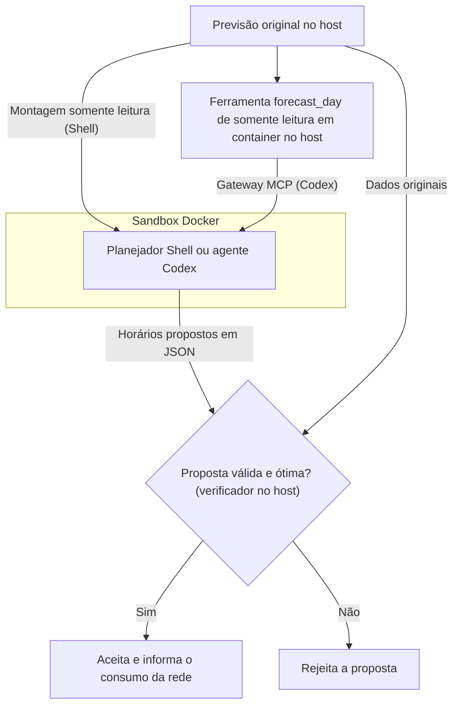

# Solar Dispatch Lab

[English](README.md) · **Português do Brasil**

> **Confie no verificador, não no agente.** Um planejador dentro de um sandbox Docker só pode propor. O host decide, usando uma previsão que o sandbox não consegue alterar.

Execute um planejador de recarga no **Docker Sandboxes** e valide a proposta no host. O sandbox recebe uma área de trabalho gravável e uma previsão solar de somente leitura. O host mantém a previsão original e toma a decisão final.

O exercício usa dados sintéticos. Um veículo elétrico precisa de **6 kWh**, e o planejador deve escolher as duas horas de menor consumo de energia da rede.

## Execute o experimento com Docker

Na raiz do repositório, com Bash, Python 3.13 e uma sessão autenticada no `sbx` em uma máquina com suporte à virtualização local:

```bash
bash lab/demo.sh sandbox
```

O script exibe o plano do ambiente, cria uma microVM Shell e executa o comando `solar-plan` do kit. O verificador no host imprime:

```json
{"decision": "accepted", "hours": [10, 11], "grid_wh": 600}
```

Para guardar uma transcrição revisável da execução, rode `bash lab/record.sh` em seguida. Veja [Record evidence](docs/SANDBOX-LAB.md#record-evidence).

Para a primeira configuração, incluindo a inicialização da política de rede local, consulte o [roteiro de Docker Sandboxes](docs/SANDBOX-LAB.md#1-local-isolation-and-network-policy).

## Como o experimento funciona



## Cadeia de suprimentos

As duas imagens rodam sobre uma Docker Hardened Image, sem shell nem gerenciador de pacotes, com um usuário sem privilégios. O Docker Scout comparou as imagens base em 20/11/2026 para linux/arm64, avaliando as tags publicadas, não os digests fixados. Veja a [evidência](docs/evidence/2026-11-20-p1b-supply-chain.md).

| Base do runtime | Vulnerabilidades (C/H/M/L) | Críticas ou altas com correção | Usuário root | Saúde no Scout |
| --- | --- | --- | --- | --- |
| `python:3.13-slim` | 0 / 11 / 8 / 34 | 8 | Sim | D (39%) |
| `dhi.io/python:3.13` | 0 / 2 / 11 / 4 | 0 | Não | A (94%) |

A imagem da aplicação caiu de 218 MB para 133 MB. A cada push no `main`, o CI publica no GitHub Container Registry as imagens, com SBOM e proveniência, e o kit do sandbox, com a sua política de rede.

## Explore outras etapas

| Experimento | O que observar |
| --- | --- |
| [Sistema de arquivos e política de rede](docs/SANDBOX-LAB.md#1-local-isolation-and-network-policy) | Confirme que a área de trabalho é gravável e a previsão é somente leitura. Mostre que a política do kit, que nega toda saída de rede, bloqueia um host liberado pela política global, e identifique a regra no log. |
| [Codex via MCP](docs/SANDBOX-LAB.md#2-codex-credentials-and-mcp) | Dê ao Codex um catálogo MCP estático, valide a proposta no host, teste se ele alcança um servidor que não recebeu e compare com um gateway dinâmico. |
| [Buildx e cadeia de suprimentos](docs/SANDBOX-LAB.md#3-kit-local-preview-and-supply-chain) | Compile as imagens sobre um runtime Docker Hardened Image, sirva a previsão em loopback e inspecione o SBOM e a proveniência que o CI publica com as imagens e o kit. |
| [Docker Cloud](docs/SANDBOX-LAB.md#4-cloud-execution-and-transfer) | Execute o planejador em um sandbox temporário na nuvem e valide o resultado no host. |

A documentação técnica está em inglês.

[Modelo de recarga](docs/DISPATCH.md) · [Arquitetura](docs/ARCHITECTURE.md) · [Governança](governance/README.md) · [Desenvolvimento e testes locais](docs/DEVELOPMENT.md)
