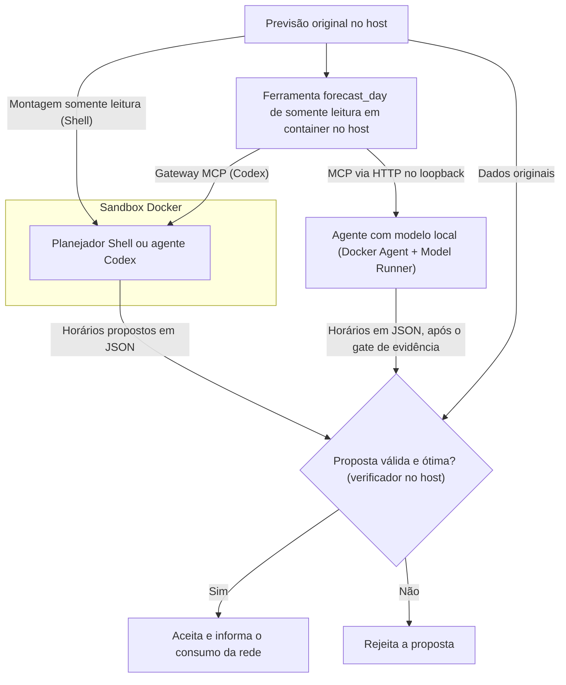

# Solar Dispatch Lab

[English](README.md) · **Português do Brasil**

[](https://github.com/brunovicco/solar-dispatch-lab/actions/workflows/quality.yml)

Um laboratório prático das ferramentas do Docker para agentes de IA: **Docker Sandboxes, kits de sandbox, o gateway MCP, Docker Model Runner, Docker Agent, Docker Hardened Images e atestações do Buildx**. Cada descoberta abaixo foi medida com as versões listadas e aponta para a seção do roteiro ou para o transcript gravado.

> **Confie no verificador, não no agente.** Um planejador só pode propor. O host decide, usando dados que o planejador não consegue alterar e evidências de como a resposta foi produzida.

A tarefa é pequena de propósito. Uma previsão solar sintética lista quatro horas, e um veículo elétrico precisa de dois blocos de recarga de uma hora. Três planejadores propõem as horas que puxam menos energia da rede: um script determinístico e o Codex dentro de sandboxes Docker, e um modelo local via Docker Agent. Um único verificador no host aceita ou rejeita cada proposta.

## Recursos do Docker no laboratório

| Recurso | O que o laboratório faz com ele | Roteiro |
| --- | --- | --- |
| Docker Sandboxes (`sbx`) | Executa o planejador numa microVM com área de trabalho gravável e previsão somente leitura | [1](docs/SANDBOX-LAB.md#1-local-isolation-and-network-policy) |
| Kits de sandbox (v3) | Entrega a ferramenta do planejador e uma política que nega toda saída de rede num único kit, validado contra o schema oficial | [1](docs/SANDBOX-LAB.md#1-local-isolation-and-network-policy), [3](docs/SANDBOX-LAB.md#3-kit-local-preview-and-supply-chain) |
| Arquivos de ambiente | Declaram montagens, fixam os kits dos agentes por digest e declaram servidores MCP | [1](docs/SANDBOX-LAB.md#1-local-isolation-and-network-policy), [2](docs/SANDBOX-LAB.md#2-codex-credentials-and-mcp) |
| Gateway MCP | Compara catálogos de ferramentas estático e dinâmico para o Codex, com um servidor isca | [2](docs/SANDBOX-LAB.md#2-codex-credentials-and-mcp) |
| Docker Model Runner | Serve o `ai/qwen3:4b` no host, sem chave de API | [5](docs/SANDBOX-LAB.md#5-local-model-through-docker-agent) |
| Docker Agent | Define o planejador local em YAML e o executa sem interface, com transcript | [5](docs/SANDBOX-LAB.md#5-local-model-through-docker-agent) |
| Compose `models` | Declara o modelo, o servidor de previsão e o Docker Agent como uma única stack, com o agente num contêiner somente leitura | [5](docs/SANDBOX-LAB.md#the-same-planner-as-a-compose-stack) |
| Docker Hardened Images | Runtime das imagens da aplicação e do servidor MCP | [3](docs/SANDBOX-LAB.md#3-kit-local-preview-and-supply-chain) |
| Buildx, GHCR e cosign | Publica imagens multiarquitetura com SBOM e proveniência, e o kit como artefato OCI, todos assinados sem chave | [3](docs/SANDBOX-LAB.md#published-images-and-attestations) |
| Docker Scout | Compara o runtime endurecido com a imagem oficial | [Cadeia de suprimentos](#cadeia-de-suprimentos) |
| Sandboxes na Docker Cloud | Executa o planejador num sandbox temporário na nuvem | [4](docs/SANDBOX-LAB.md#4-cloud-execution-and-transfer) |

## O que os experimentos mostraram

1. **Um deny no kit vence qualquer allow.** O kit nega toda saída de rede em execução. O `github.com`, liberado pela política global `balanced`, foi recusado com `kit:solar-dispatch:deny`, inclusive depois de um allow restrito ao sandbox. O `sbx inspect` não mostra regras de kit; o `sbx policy check` e o log mostram. [Evidência](docs/evidence/2026-11-20-p1a-static.md)
2. **O MCP estático isola servidores que o sandbox não recebeu.** O gateway ainda oferece `mcp_exec` e `code_mode`, mas nenhum dos dois alcançou um servidor isca registrado no host. Num sandbox dinâmico, o controle positivo, o Codex adicionou a isca e recebeu o canário. [Roteiro](docs/SANDBOX-LAB.md#can-a-static-sandbox-reach-servers-it-was-not-given) · [Evidência](docs/evidence/2026-11-20-p1a-dynamic.md)
3. **`mcp.servers` num arquivo de ambiente seleciona o modo estático,** e esses servidores ficam presos ao ambiente: carregar um deles em outro sandbox retornou `403 Forbidden`. [Roteiro](docs/SANDBOX-LAB.md#contrast-dynamic-mcp-and-the-positive-control)
4. **Uma resposta maliciosa escrita dentro do sandbox é rejeitada no host.** Uma proposta com a chave `hours` duplicada falha com `Duplicate JSON key`, porque parsers diferentes discordam sobre qual valor vale. [Roteiro](docs/SANDBOX-LAB.md#static-mcp-declared-in-the-environment-file)
5. **Uma resposta certa pode ser um palpite.** A primeira resposta aceita do modelo local veio sem nenhuma chamada à ferramenta de previsão. O verificador confere resultados, então o host agora também exige, no transcript, a evidência de que o agente leu a previsão. [Evidência](docs/evidence/2026-11-20-p2-local-model.md)
6. **O Docker Agent espera 30 segundos por turno pelas ferramentas.** Um servidor MCP stdio iniciado por sessão com `docker run` levou cerca de 44 segundos dentro do Docker Agent, e o modelo rodou sem a ferramenta. O mesmo handshake levou menos de 2 segundos com o cliente MCP em Python. Um container em execução servindo HTTP no loopback resolveu. [Roteiro](docs/SANDBOX-LAB.md#check-the-process-not-only-the-result)
7. **Modelos locais têm limites práticos.** A saída estruturada em modo ferramenta recebeu `HTTP 400` do llama.cpp do Model Runner, e o raciocínio não pôde ser desligado. Num MacBook Air sem ventoinha, cada execução levou de 4,5 a 6 minutos enquanto o macOS estrangulava o chip. [Roteiro](docs/SANDBOX-LAB.md#structured-output-and-reasoning-with-a-local-model)
8. **O runtime endurecido eliminou todas as vulnerabilidades críticas ou altas com correção disponível** e reduziu a imagem da aplicação de 218 MB para 133 MB. Veja [Cadeia de suprimentos](#cadeia-de-suprimentos).

## Início rápido

O verificador roda em qualquer lugar com Python 3.13:

```bash
bash lab/demo.sh local
```

A imagem publicada só precisa do Docker, em amd64 ou arm64:

```bash
docker run --rm --read-only --network none ghcr.io/brunovicco/solar-dispatch:main
```

O experimento com sandbox precisa do CLI `sbx`, autenticado, numa máquina com suporte a virtualização local:

```bash
bash lab/demo.sh sandbox
```

Ele planeja o ambiente do sandbox, cria uma microVM Shell, executa o `solar-plan` do kit e valida a proposta no host:

```json
{"decision": "accepted", "hours": [10, 11], "grid_wh": 600}
```

O experimento com modelo local precisa do Docker Model Runner e do Docker Agent v1.147.0 ou posterior. Execute `bash lab/agent.sh` depois da configuração da [seção 5](docs/SANDBOX-LAB.md#5-local-model-through-docker-agent), ou `bash lab/agent.sh compose` para subir a stack inteira, inclusive o Docker Agent, a partir do `compose.yaml`. Grave os seus próprios transcripts com `bash lab/record.sh`, descrito em [Record evidence](docs/SANDBOX-LAB.md#record-evidence).

## Como funciona



O verificador lê no máximo 4 KiB de JSON estrito, rejeita chaves duplicadas e só aceita um plano se nenhuma hora não usada puxar menos energia da rede. O [modelo de despacho](docs/DISPATCH.md) descreve o cálculo.

## Cadeia de suprimentos

As duas imagens rodam sobre uma Docker Hardened Image, sem shell nem gerenciador de pacotes, com um usuário sem privilégios. O Docker Scout comparou as imagens base em 20/11/2026 para linux/arm64, avaliando as tags publicadas, não os digests fixados. Veja a [evidência](docs/evidence/2026-11-20-p1b-supply-chain.md).

| Base do runtime | Vulnerabilidades (C/H/M/L) | Críticas ou altas com correção | Usuário root | Saúde no Scout |
| --- | --- | --- | --- | --- |
| `python:3.13-slim` | 0 / 11 / 8 / 34 | 8 | Sim | D (39%) |
| `dhi.io/python:3.13` | 0 / 2 / 11 / 4 | 0 | Não | A (94%) |

A cada push no `main`, o CI publica no GitHub Container Registry, para amd64 e arm64:

| Pacote | Conteúdo |
| --- | --- |
| `ghcr.io/brunovicco/solar-dispatch` | CLI do planejador e do verificador, com SBOM e proveniência |
| `ghcr.io/brunovicco/solar-forecast-mcp` | Servidores MCP de previsão (somente leitura) e isca, com SBOM e proveniência |
| `ghcr.io/brunovicco/solar-kit` | Kit do sandbox, com a política que nega saída de rede nas anotações do manifest |

Cada imagem e o kit são assinados por digest com cosign sem chave (keyless), vinculados ao workflow `quality` na `main`:

```bash
cosign verify ghcr.io/brunovicco/solar-dispatch:main \
  --certificate-identity https://github.com/brunovicco/solar-dispatch-lab/.github/workflows/quality.yml@refs/heads/main \
  --certificate-oidc-issuer https://token.actions.githubusercontent.com
```

O Dependabot mantém atualizados os digests das imagens base, as actions e as dependências Python.

## Versões testadas

| Componente | Versão |
| --- | --- |
| CLI do Docker Sandboxes (`sbx`) | v0.54.0 |
| Docker Agent | v1.163.0 |
| Docker Model Runner | llama.cpp b9879, Metal |
| Modelo local | `ai/qwen3:4b` |
| Máquinas | macOS em Apple Silicon; Ubuntu no GitHub Actions |

O `sbx env` e partes do Docker Agent são experimentais, então comandos e formatos de arquivo podem mudar.

## Mapa do repositório

| Caminho | Conteúdo |
| --- | --- |
| `lab/` | Arquivos de ambiente do sandbox, o kit, o planejador do Docker Agent e os scripts de demo, probe, gravação e agente |
| `compose.yaml` | O planejador com modelo local como uma stack: modelo, servidor de previsão e Docker Agent |
| `integrations/` | Servidores MCP de previsão e isca, a imagem deles e as checagens MCP |
| `src/solar_dispatch/` | Planejador, verificador e o gate de evidência do transcript |
| `docs/` | [Roteiro](docs/SANDBOX-LAB.md), [arquitetura](docs/ARCHITECTURE.md), [modelo de despacho](docs/DISPATCH.md) e [evidências](docs/evidence/) |
| `governance/` | Inventários de agentes, ferramentas, servidores MCP e terceiros |

[Desenvolvimento e checagens locais](docs/DEVELOPMENT.md) · [Governança](governance/README.md) · [Licença](LICENSE)
