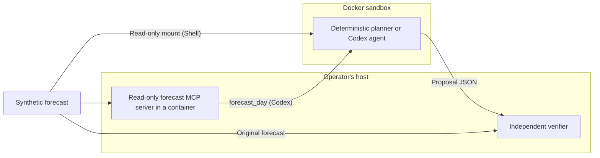

# Architecture

## Context

Solar Dispatch Lab schedules one-hour EV charging blocks from a synthetic forecast. A planner or
Codex agent proposes a schedule inside a Docker sandbox. The operator runs the verifier on the
host using the original forecast. The [dispatch model](DISPATCH.md) explains the calculation and
the CLI contract.

## Layers

```text
src/solar_dispatch/
├── domain/        # dispatch.py: forecast parsing, ranking, and the exchange check
└── entrypoints/   # dispatch.py: plan/verify CLI; agent_evidence.py: transcript gate
```

The package uses only the standard library. The forecast MCP server and the protocol check live
in `integrations/` and install the `mcp` extra on their own.

### Domain

Integer watt-hour arithmetic over a closed forecast: no I/O, no clock, no randomness. The same
functions rank the hours for the planner and check a proposal for the verifier, so a planner
that runs this code still has to pass an independent check of its output on the host.

### Entrypoints

Command-line boundaries. `dispatch` reads a bounded proposal from stdin, rejects duplicate keys
and non-standard constants, and translates JSON into domain calls. `agent_evidence` reads a
Docker Agent transcript and releases the final answer only if a `forecast_day` call precedes it.

## Dependency rule

```text
entrypoints -> domain
domain      -> standard library only
```

`scripts/validate_architecture.py` enforces the direction in the quality gate. The scaffold's
`application/` and `adapters/` layers were removed because the lab has no use cases, ports, or
external systems behind them; reintroduce them when a planner needs one.

## Cross-cutting decisions

- Trust boundary: planners run in a sandbox or container; the verifier runs on the host against
  the original forecast and decides.
- Input: proposals are capped at 4 KiB and parsed strictly; transcripts are capped at 64 MiB.
- Evidence: transcripts stay on the operator's machine. Files under `docs/evidence/` record
  metadata only: no prompts, responses, credentials, or personal data.
- Errors: rejections exit with status 1 and a one-line reason on stderr.
- Packaging: one multi-stage Dockerfile per image, digest-pinned bases, Docker Hardened Images
  at runtime, published for amd64 and arm64 with SBOM, provenance, and a keyless signature.

## Diagrams



The domain module owns parsing, ranking, and verification. The dispatch entrypoint translates
between JSON and the domain. The MCP server runs in its own container without network, on a read-only filesystem, and
exposes the synthetic fixture to the Codex workflow through the Docker Sandboxes gateway. The
planner's kit denies all runtime egress. A third planner, defined with Docker Agent and served
by Docker Model Runner, reads the same MCP server and returns hours as JSON to the same
verifier. An evidence gate on the host first checks the agent's transcript and rejects any answer
given without a `forecast_day` call.
