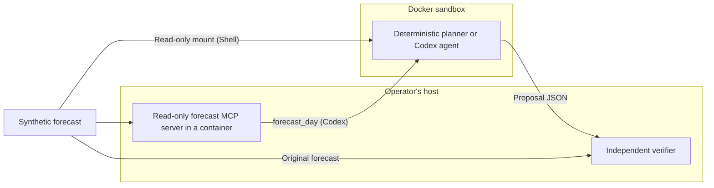

# Architecture

## Context

Solar Dispatch Lab schedules one-hour EV charging blocks from a synthetic forecast. A planner or
Codex agent proposes a schedule inside a Docker sandbox. The operator runs the verifier on the
host using the original forecast. The [dispatch model](DISPATCH.md) explains the calculation and
the CLI contract.

## Layers

```text
src/solar_dispatch/
├── domain/
├── application/
├── adapters/
└── entrypoints/
```

### Domain

Pure business concepts, invariants, Value Objects, domain services, events, and domain errors.

### Application

Use cases, commands, queries, ports, authorization decisions, and transaction coordination.

### Adapters

Implementations of application ports for databases, messaging, HTTP, cache, storage, identity, and external SDKs.

### Entrypoints

HTTP, CLI, jobs, events, and serverless handlers. Entrypoints validate and translate transport data but do not own business rules.

## Dependency rule

```text
entrypoints -> application -> domain
adapters    -> application/domain
domain      -> no outer layer
```

## Cross-cutting decisions

- Configuration: environment variables validated at startup.
- Logging: structured events to stdout/stderr.
- Tracing: the service-only OpenTelemetry adapter exports trace data over OTLP HTTP/protobuf only
  when an endpoint is configured. It propagates W3C Trace Context, but not baggage, and keeps the
  SDK lifecycle at the composition-root boundary. The separate Langfuse LLM observer remains an
  opt-in adapter with its existing contract.
- Errors: infrastructure errors translated at adapters; external errors mapped at entrypoints.
- Time: UTC internally with timezone-aware values.
- Money: `Decimal` wrapped in a domain Value Object.
- Idempotency: required for externally visible side effects.
- Packaging: containerized via the repo `Dockerfile` (multi-stage, uv-based); the runtime `CMD` is defined per project.

## Diagrams



The domain module owns parsing, ranking, and verification. The dispatch entrypoint translates
between JSON and the domain. The MCP server runs in its own container without network, on a read-only filesystem, and
exposes the synthetic fixture to the Codex workflow through the Docker Sandboxes gateway. The
planner's kit denies all runtime egress. A third planner, defined with Docker Agent and served
by Docker Model Runner, reads the same MCP server and returns schema-checked hours to the same
verifier.
